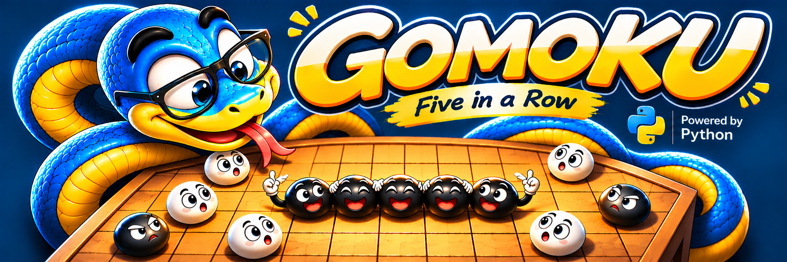
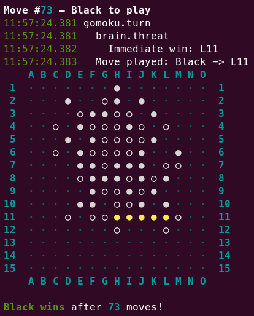
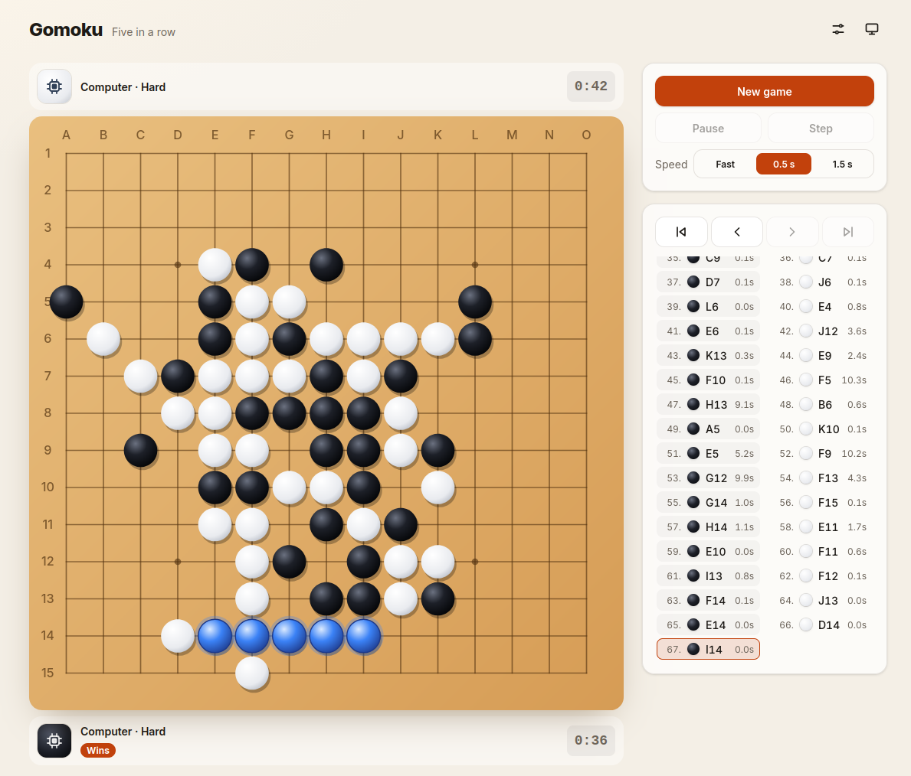

# Gomoku


A **Gomoku (Five in a Row)** engine with multiple AI brains, a terminal
interface, game recording, diagnostics, and opening book support.

---

## About this project

This is a fun project I started back as a university student. It was meant
to be a testing ground for learning:

- Python
- algorithms
- object-oriented programming and design patterns
- git
- testing
- documentation
- the theory of two-player zero-sum games

Over the years, new tools and technologies have come along, and the project
adopts them as they appear:

- GitHub and continuous integration
- free-threaded Python (no GIL)
- uv as the package manager
- Pydantic
- AI-assisted development

---

## Quick Start

```bash
# Install dependencies
uv sync

# Play as Black (keyboard) against the strongest AI (threat brain)
uv run gomoku play --black keyboard --white threat

# Watch two AIs play each other
uv run gomoku play --black threat --white alphabeta --record

# Replay a recorded game
uv run gomoku playback recordings/gomoku_20260405_143012.json
```



### Play in the browser

```bash
docker compose up --build
```

Open <http://localhost:8080>.  See [docs/WEB_ARCHITECTURE.md](docs/WEB_ARCHITECTURE.md)
for how the website is built and run.



---

## Features

| Feature | Description |
|---------|-------------|
| **6 AI brains** | Random, minimax, negamax, alpha-beta (8 enhancements), threat (VCF/VCT/PNS), MCTS |
| **Human play** | Keyboard input via terminal |
| **Game recording** | Incremental JSON with MD5 checksums |
| **Diagnostics** | Per-move brain internals (`.diag.jsonl`) + `gomoku analyze` blunder/time-spike reporter |
| **Playback overlay** | Arrow-key replay overlays diagnostics when a companion file exists |
| **Opening book** | Hardcoded + file-based with 8-fold symmetry |
| **Configuration** | TOML + environment variables + CLI flags |
| **Observability** | Pydantic Logfire instrumentation |
| **JIT acceleration** | Optional Numba-compiled evaluation and bitboard |

---

## Architecture

The project is a **uv workspace** with four packages:

```
gomoku-cli ─────┐
  CLI, tooling  ├──▶  gomoku-brain  ──▶  gomoku (core)
gomoku-fastapi ─┘       AI brains          Board, rules, models
  HTTP API
```

- **gomoku** — Core engine: board, rules, game loop, recording, configuration.
- **gomoku-brain** — AI move providers: threat search, alpha-beta, MCTS, evaluation.
- **gomoku-cli** — Terminal interface: game display, keyboard input, playback,
  and the `match` / `review` strength tools.
- **gomoku-fastapi** — Versioned HTTP API over the engine and brains (see its
  [README](packages/gomoku-fastapi/README.md)).

See [docs/ARCHITECTURE.md](docs/ARCHITECTURE.md) for the full architecture
description.

---

## AI Brains

| Brain | Algorithm | Strength | Best at |
|-------|-----------|----------|---------|
| `random` | Uniform random | Weakest | Testing |
| `minimax` | Classic minimax | Weak | Educational |
| `negamax` | Negamax | Weak–medium | Educational |
| `alphabeta` | Negamax + alpha-beta + 8 enhancements | Strong | Positional play |
| `threat` | VCF + PNS/VCT + alpha-beta fallback | **Strongest** | Tactical endgame |
| `mcts` | PUCT + heuristic priors | Medium | Exploratory play |

The **threat brain** is the strongest — it chains forcing moves (threats the
opponent must answer) up to 20 plies deep, then falls back to alpha-beta for
non-tactical positions.

The **alpha-beta brain** uses Zobrist transposition tables, iterative
deepening, principal variation search, quiescence search, aspiration windows,
futility pruning, late move reduction, null-move pruning, and threat
extensions.

**Writing a brain:** subclass `gomoku_brain.base.Brain[YourSettings]` with
`name="yours"` and implement `choose_move`; declaring the class registers it.
A brain in its own package plugs in through a `gomoku.brains` entry point.
See the tutorial [docs/WRITING_A_BRAIN.md](docs/WRITING_A_BRAIN.md) and
[ARCHITECTURE.md](docs/ARCHITECTURE.md#ai-brains).

**Trying another evaluation:** the search brains take their evaluation and
candidate moves by name (`evaluator`, default `"pattern"`; `move_generator`,
default `"radius"`).  Register one with `gomoku.strategies.register_evaluator`
and compare it with the built-in:

```bash
uv run gomoku match --a brain=alphabeta --b brain=alphabeta,evaluator=yours --games 300
```

See [ARCHITECTURE.md](docs/ARCHITECTURE.md#search-strategies).

---

## CLI Commands

### `play` — Start a game

```bash
uv run gomoku play [OPTIONS]
```

| Option | Default | Description |
|--------|---------|-------------|
| `--black NAME[,KEY=VALUE...]` | `keyboard` | Black player (brain name or alias, optionally with settings changed) |
| `--white NAME[,KEY=VALUE...]` | `random` | White player (same form) |
| `--board-size N` | from config | Board size (5–25) |
| `--config PATH` | `gomoku.toml` | Configuration file |
| `--record / --no-record` | from config | Enable game recording |
| `--record-dir PATH` | from config | Recording directory |
| `--diagnostics / --no-diagnostics` | from config | Enable per-move diagnostics |
| `--diagnostics-dir PATH` | from config | Diagnostics directory |
| `--opening-book PATH` | — | Opening book JSON file |

Brain settings can be changed for one game after the brain's name,
on top of its settings in `gomoku.toml`:

```bash
uv run gomoku play --black threat,depth=8,fallback.depth=8 --white alphabeta,depth=8
```

- A dotted key reaches into a nested table: `fallback.depth=8`,
  `threats.own.split_threes=true`.
- Values are TOML values (`8`, `2.5`, `true`, `"text"`); a plain word is a
  string (`threat_search=vct`).
- Keys are checked against the brain's settings, nested tables included:
  a misspelt key (`dpeth=8`) is an error that lists the valid keys, not
  silently ignored.

The same `KEY=VALUE` parts work in the engines of `match`, `review` and
`bench`, and in `generate-book --brain`.

### `playback` — Replay a recorded game

```bash
uv run gomoku playback <file.json> [--from-move N]
```

Navigate with `←` previous, `→` next, `q` quit.  If a companion
`<file>.diag.jsonl` file sits next to the recording (default when playing
with `--record --diagnostics`), per-move brain internals are overlaid under
each position automatically.

### `analyze` — Post-game diagnostics review

```bash
uv run gomoku analyze <file.diag.jsonl> [--json]
```

Prints per-player stats (moves, think time, avg/max depth, total nodes,
blunder count) and a table of suspect moves flagged by five heuristics
(`eval_drop`, `bypassed_top_candidate`, `time_spike`, `opp_double_four`,
`opp_forced_win`).  `--json` emits a single machine-readable document.
See [docs/DIAGNOSTICS.md](docs/DIAGNOSTICS.md#post-game-analysis-gomoku-analyze)
for details.

### `generate-book` — Build a file-based opening book

```bash
uv run gomoku generate-book [OPTIONS]
```

Runs a configurable brain on the early-game search tree and saves an
opening book JSON file.  See
[docs/OPENING_BOOK.md](docs/OPENING_BOOK.md#generating-a-book).

### `match` — Measure which engine is stronger

```bash
# A git revision against the working tree
uv run gomoku match --a brain=threat,rev=master --b brain=threat --games 40 --jobs 3

# Two settings of the same brain
uv run gomoku match --a brain=threat --b brain=threat,config=other.toml --games 40

# The same, with the settings on the command line
uv run gomoku match --a brain=threat --b brain=threat,pns_nodes=60000,fallback.depth=4 --games 40
```

Plays engine A against engine B over generated openings, each opening
twice with colours swapped, and reports wins, score with a 95% interval
(computed per opening pair, which cancels colour bias), the implied Elo
difference and think time per move.  An engine is
`brain=NAME[,rev=GIT_REV][,config=PATH][,KEY=VALUE...]` (`KEY=VALUE`
changes a brain setting, as in `play`): without `rev` it runs the
working tree, with `rev` that commit is exported to a per-commit cache
under the system temp directory (the first start of a revision compiles
its kernels).  Openings where either colour already has a forced win are
skipped unless `--any-openings` is given.  `--out games.json` saves every
game.  Think times are only comparable at `--jobs 1`.

### `review` — Check a change for blunders before a long match

```bash
uv run gomoku review --a brain=threat,rev=master --b brain=threat --games 6 --jobs 3
```

A quick gate to run before `match`: plays a few games between the
baseline (A) and the candidate (B), then checks every engine move with
an *oracle*, a threat-space proof-number search with a much larger
budget (`--oracle-nodes`, `--oracle-time`) running from a separate
source tree (`--oracle-rev`, by default A's revision), so a bug in the
candidate's search can't vouch for its own moves.  An older oracle,
though, cannot see a threat B newly detects, and reports B's sound wins
as unsound.  So each blunder is also re-judged by B's own search (turn
off with `--no-second-oracle`): one the two oracles disagree on is
**DISPUTED** — listed, not retried, not counted as a bug — and makes the
verdict `WARN`, to be checked by hand.  `--oracle-rev worktree` judges
everything with the working tree's search.  It flags:

| Blunder | Meaning |
|---|---|
| `missed_win` | The mover could complete five, or had a proven forced win that is disproved after its move and the reply |
| `missed_block` | The opponent threatened five on a single cell and the mover played elsewhere |
| `losing_move` | After the move the opponent has a proven forced win; the report shows a move that held |
| `unsound_proof` | The brain claimed a forced win the oracle disproves, or the oracle's own proof failed after it was followed |
| `unconverted_win` | The brain claimed a forced win (`vcf_win`, `pns_win`, `vct_win`), but a later move of its own was no win, or the game ended without its five.  Needs no oracle to spot; the report draws the position of the claim and of the break |

An `unconverted_win` where the oracle disproves the win at the break is a
bug (the claim was unsound); one where the oracle still proves it is
treated like a missed win.  Each blunder (except `unsound_proof`, which is
always a bug) is then
replayed with the same engine: once unchanged, then with larger
settings, cheapest first — for the threat brain a 10× PNS budget, one
more fallback ply, a doubled fallback width, and all of them together.
The first setting that finds a good move is reported as **TUNING**,
with its think-time cost; if none does, the blunder is a **BUG** in the
brain's logic:

```
board: X black, O white (lower case: the move just before), ! played, * a better move
game 1, move 18: B (alphabeta, white) played I3 — losing move: the opponent then wins by force; I2 held
    decision: vcf_breaker, 0.0 s
    retried: repeat no I3 (0.0 s) | deeper no I3 (0.0 s) | wider no I3 (0.0 s) | all no I3 (0.0 s)
    => BUG: no setting tried finds a good move; the brain's logic needs a fix
        E F G H I J K L M
     10 . . . . . . O . .
      9 . . . . . . X . .
      8 . . X . X . . . .
      7 . . O O x . X . .
      6 . . O X O . . . .
      5 . . O X O . . . .
      4 . . X X O . . . .
      3 . . . . ! . . . .
      2 . . . . * . . . .

Verdict: FAIL — B has 4 blunder(s) needing a fix in the brain's code, A has 1; fix them before a long match
```

Each blunder's position is drawn as it was before the move (rows
cropped here); `--no-boards` leaves the boards out.

The verdict is `FAIL` (exit status 1) when B has more BUG blunders than
A, `WARN` when B has blunders or disputed ones, and `PASS` otherwise.  Fix a `FAIL`
before spending time on a long `match`.  `--out review.json` saves the
games, the oracle's verdict for every position and each blunder with
its retries; `--no-escalate` skips the retries.

**In CI.**  Every pull request that touches the engine or `gomoku.toml`
runs a 6-game review against its base branch (`.github/workflows/review.yml`)
and fails on `FAIL`.  Adding the `match` label to a pull request runs the
review and then a 300-game match against the base
(`.github/workflows/match.yml`; remove and re-add the label to run it
again, or start it by hand).  The match fails only when the pull request
is significantly weaker (`gomoku match --fail-if-weaker`).  The speed
benchmark below runs on the same pull requests (`.github/workflows/perf.yml`).
Results are in the run summary and as `review.json` / `match.json` /
`bench-*.json` artifacts.

### `bench` — Catch speed regressions

```bash
uv run gomoku bench --a brain=threat,rev=master --b brain=threat --profile 25
```

Times engine B (the candidate) against engine A (the baseline) on a fixed
set of 48 positions from self-play games (16 each from the opening, middle
and endgame; `--positions` takes another set).  The two engines alternate
on every position and each time is the median of `--repeat` runs (3), so
a noisy machine affects both alike.  The report gives total and per-phase
time, B / A, the largest slowdowns, and the positions where B plays a
**different move** — a change of behaviour, not only of speed (on a busy
machine a time limit such as `pns_time_s` can also change a move or two).
`--profile N` adds B's top N functions by self time (cProfile).

The verdict is `FAIL` (exit status 1) when B thinks more than 25% slower
(`--fail-slower`), `WARN` above 10% (`--warn-slower`), `PASS` otherwise.
In CI every pull request that touches the engine benchmarks the `threat`
and `alphabeta` brains against its base.

---

## Configuration

Runtime settings are managed via `gomoku.toml` with pydantic-settings.

**Priority** (highest → lowest):
1. CLI flags
2. Environment variables (`GOMOKU_*` prefix)
3. `gomoku.toml`
4. Built-in defaults

The TOML file is discovered automatically: the loader walks up from the
current working directory until it finds `gomoku.toml` or hits a project
root marker (`pyproject.toml` / `.git`).  Set `GOMOKU_CONFIG=/path/to/config.toml`
to bypass discovery and use an explicit file.

Brain aliases allow multiple configurations of the same engine:

```toml
[brains.threat_fast]
type = "threat"
pns_nodes = 10_000      # a third of the shipped threat brain's PNS budget

[brains.threat_fast.fallback]
depth = 4

[brains.alphabeta_deep]
type = "alphabeta"
depth = 6
lmr = true
```

---

## Documentation

| Document | Description |
|----------|-------------|
| [docs/ARCHITECTURE.md](docs/ARCHITECTURE.md) | Workspace structure, packages, data models, configuration system |
| [docs/WRITING_A_BRAIN.md](docs/WRITING_A_BRAIN.md) | Tutorial: write a brain plug-in, install it, play, match and test it |
| [docs/THREATS.md](docs/THREATS.md) | Threat classification, pattern scoring, fork detection, defensive strategies |
| [docs/OPENING_BOOK.md](docs/OPENING_BOOK.md) | 8-fold symmetry, hardcoded and file-based books, generation |
| [docs/DIAGNOSTICS.md](docs/DIAGNOSTICS.md) | Per-move diagnostics: format, context API, reading and analysing output |
| [docs/TROUBLESHOOTING.md](docs/TROUBLESHOOTING.md) | Manual for analysing games — blunders, mistakes, inefficiencies, root causes, fixes |
| [packages/gomoku-brain/docs/THREAT_BRAIN.md](packages/gomoku-brain/docs/THREAT_BRAIN.md) | VCF, VCT, PNS algorithms with pseudocode and examples |
| [packages/gomoku-brain/docs/ALPHABETA_BRAIN.md](packages/gomoku-brain/docs/ALPHABETA_BRAIN.md) | Eight alpha-beta enhancements with worked examples |
| [packages/gomoku-brain/docs/MCTS_BRAIN.md](packages/gomoku-brain/docs/MCTS_BRAIN.md) | PUCT, heuristic priors, Dirichlet noise, VCF safety gate |
| [packages/gomoku/docs/RECORDING.md](packages/gomoku/docs/RECORDING.md) | Game recording JSON format, playback controls, Python API |

---

## Development

```bash
# Sync all packages
uv sync

# Run tests
uv run pytest

# Lint and format (both enforced in CI: `ruff check` and `ruff format --check`)
uv run ruff check --fix .
uv run ruff format .

# Type check (also in CI): the interfaces in gomoku.interfaces are enforced here
uv run pyright
```

### Project layout

```
pyproject.toml              ← uv workspace root
gomoku.toml                 ← runtime configuration
packages/
  gomoku/                   ← core engine
  gomoku-brain/             ← AI brains
  gomoku-cli/               ← terminal interface
recordings/                 ← saved games & diagnostics
docs/                       ← project documentation
```

---

## License

Released under the [MIT License](LICENSE).
