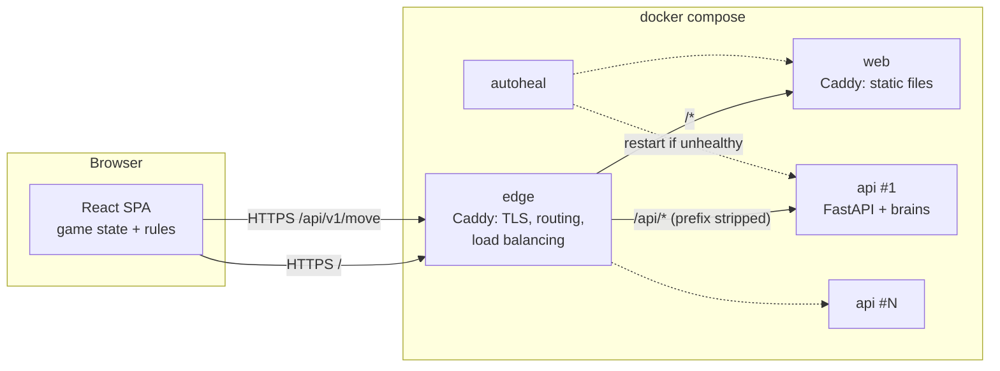
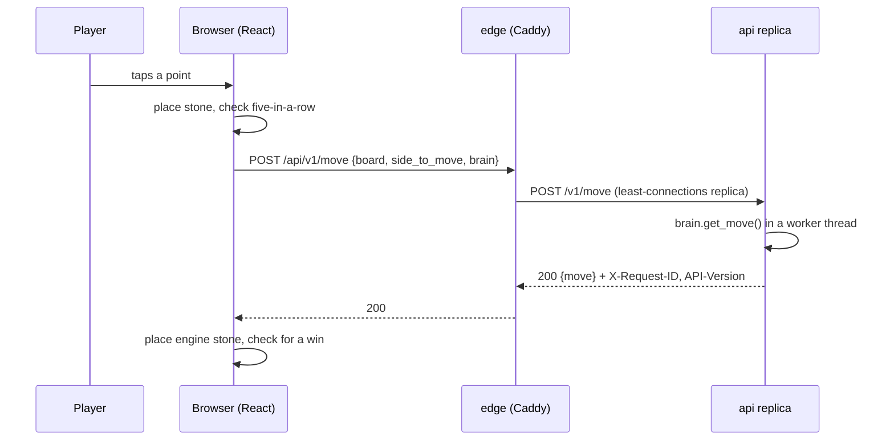

# Web architecture

How the Gomoku website is built, run and operated: the browser game in
`web/`, the REST API in `packages/gomoku-fastapi`, and the containers in
`deploy/` and `compose.yaml`.  Work on the website is tracked in
[issue #82](https://github.com/dominik-skorka/gomoku/issues/82).

## Goals

| Goal | How it is met |
|---|---|
| Runs on a laptop and on any host | One `compose.yaml`; the same images everywhere |
| Modular, each part replaceable | Three images (`api`, `web`, `edge`), each rebuilt, upgraded and restarted alone |
| Survives failures | Stateless API replicas; restart policies + healthchecks + autoheal; the proxy retries another replica |
| Scales | `docker compose up --scale api=N`; the edge balances over every replica |
| Modern look on phone, tablet and laptop | React 19 SPA, responsive layout, SVG board, light/dark theme |
| Versioned | SemVer per component, `/version.json` (web) and `/v1` + OpenAPI (API) |
| Observable | `/healthz` per container, request IDs end to end, Logfire traces (see [DIAGNOSTICS](DIAGNOSTICS.md)) |

## Components



| Component | Image | Technology | Responsibility |
|---|---|---|---|
| `web` | `gomoku-web` | React 19, Vite 8, TypeScript 6, Tailwind CSS 4, Motion | The game UI; built once into static files served by Caddy |
| `api` | `gomoku-api` | Python 3.14 free-threaded, FastAPI, uvicorn (`packages/gomoku-fastapi/Dockerfile`) | Asks a brain for a move (`POST /v1/move`); stateless; Numba kernels precompiled in the image |
| `edge` | `caddy` | Caddy 2.11 | The only published port: TLS (automatic certificates), `/api` routing, load balancing, security headers |
| `autoheal` | `willfarrell/autoheal` | — | Restarts containers whose healthcheck turns `unhealthy` |

## A move, end to end



## Decisions

### ADR-1: Game state lives in the browser

**Decision.** The browser holds the board, applies the rules (`web/src/game/`)
and sends the whole position to the stateless `POST /v1/move`.  The
stateful `/v1/games` sessions stay in the API for other clients but the
website does not use them.

**Why.** Sessions are kept in one process's memory: a restart loses every
game and a second replica cannot see the first one's games (sticky sessions
or Redis would be needed).  Stateless calls make every replica equivalent,
so replicas can be added, killed or upgraded mid-game without a player
noticing.  The cost is a second copy of the win rule (about 30 lines of
TypeScript, unit-tested against the same cases as `gomoku.rules`).

**Revisit when** accounts, saved games or multiplayer arrive: then
sessions move to a shared store (Redis/Valkey) behind the existing API.

### ADR-1a: Each colour is a human or an engine

**Decision.** Game settings name a player kind per colour (`black`,
`white`: `human` or `engine` at a difficulty preset).  Human vs engine,
human vs human (one device, taking turns) and engine vs engine all follow
from that one model; the engine loop simply asks `POST /v1/move` whenever
an engine plays the side to move.

**Engine vs engine** plays itself, with pause, single step and a delay
between moves (none, 0.5 s, 1.5 s) so a game can be followed.  When the
API rate-limits a fast game (`429`), the client waits for `Retry-After`
and retries by itself.

**Resign** ends the game for the human whose turn it is (in human vs
human: the side to move), after a confirmation, and cannot be undone.
**Move navigation** (⏮ ◀ ▶ ⏭, Home / ← / → / End, or a click in the move
list) only *shows* earlier positions: the game, an engine thinking in the
background included, goes on, and ⏭ catches up with it.  Playing from an
earlier position is what Undo is for.

### ADR-2: A static SPA, not a server-rendered framework

**Decision.** React + Vite, built to static files.  No Next.js/SSR.

**Why.** A game behind a board has nothing to render on the server and no
SEO beyond one page.  Static files need no Node process in production,
cache perfectly (hashed bundles are immutable), and roll back by switching
an image tag.  React was chosen over Svelte for the size of its ecosystem.

### ADR-3: Same origin through an edge proxy

**Decision.** Caddy serves the site and proxies `/api/*` to the API on the
same origin; uvicorn runs with `--root-path /api`.

**Why.** No CORS configuration, one certificate, one place for security
headers.  Caddy obtains and renews TLS certificates by itself, so moving
from the laptop (`SITE_ADDRESS=:80`) to a domain is one variable.

### ADR-4: TypeScript types generated from OpenAPI

**Decision.** `web/openapi/v1.json` is exported from the running app code
(`scripts/export_openapi.py`), and `web/src/api/schema.d.ts` is generated
from it.  CI fails if either is stale.

**Why.** An incompatible API change then breaks the web build in the same
pull request, never the game in production.  The API's own contract test
(`tests/test_api_contract.py`) already forbids breaking changes inside `v1`.

### ADR-5: Docker Compose, not Kubernetes

**Decision.** One Compose file for the laptop and for a single host.

**Why.** Three services do not justify a cluster's operating cost.  The
images are plain OCI images, so moving to Kubernetes, Fly.io or Cloud Run
later changes deployment files, not the application.

**Caveat.** Docker restarts a container when its process exits, not when
its healthcheck fails.  The `autoheal` container closes that gap; it needs
read access to the Docker socket, which is acceptable on a single-purpose
host.

### ADR-6: Free-threaded Python in the API image

**Decision.** The image runs CPython 3.14t (no GIL) installed by `uv`, and
uvicorn's pure-Python `h11` parser.

**Why.** It is the project's interpreter (`.python-version`): brains that
probe in parallel really run in parallel.  `httptools` has not declared
free-threading support, and importing it would turn the GIL back on.

## Versioning

| Component | Version source | Where to see it |
|---|---|---|
| Web | `web/package.json` + git revision | Page footer, `GET /version.json` |
| API (server) | `packages/gomoku-fastapi/pyproject.toml` | `info.version` in `GET /api/openapi.json` |
| API (contract) | URL major version `v1` (AIP-185) | `API-Version` response header, `GET /api/versions` |
| Images | Build args `VERSION`, `REVISION` | OCI labels `org.opencontainers.image.version` / `.revision` |

## Running it

```bash
docker compose up --build
```

Then open <http://localhost:8080>.  The API's interactive docs are at
<http://localhost:8080/api/docs>.

For frontend development with hot reload, run the API (from source or in
its container) and Vite separately:

```bash
uv run gomoku-api
```

or

```bash
docker compose -f compose.yaml -f compose.dev.yaml up --build api
```

```bash
cd web && pnpm install && pnpm dev
```

Vite proxies `/api` to `127.0.0.1:8000` exactly as Caddy does in production.

### Configuration

| Variable | Default | Meaning |
|---|---|---|
| `HTTP_PORT` | `8080` | Port published on the host |
| `SITE_ADDRESS` | `:80` | Caddy site address; a domain name enables automatic HTTPS |
| `GOMOKU_RATE_LIMIT_DEFAULT` | `240/minute` | Per-IP limit on every API endpoint, per replica |
| `GOMOKU_RATE_LIMIT_COMPUTE` | `60/minute` | Per-IP limit on `/v1/move`, per replica |
| `GOMOKU_MAX_TIME_LIMIT_S` | `10` | Upper bound on a brain's think time per request |
| `LOGFIRE_TOKEN` | empty | Ship traces to Logfire when set |
| `GOMOKU_VERSION`, `GOMOKU_WEB_VERSION` | `dev` | Image tags to run |

Rate limits are kept in each replica's memory, so with N replicas a client
can get up to N times the limit.  That is fine for abuse protection; a
shared limit would need Redis.

### Operating

| Task | Command |
|---|---|
| Status of every container | `docker compose ps` |
| Logs of one component | `docker compose logs -f api` |
| Restart one component | `docker compose restart api` |
| Upgrade only the web UI | `docker compose up -d --build web` |
| Run three engine replicas | `docker compose up -d --scale api=3` |

### Building behind a TLS-intercepting proxy

Both Dockerfiles accept an optional extra CA certificate as a build secret:

```bash
docker build --secret id=extra_ca,src=/path/to/ca.pem -f packages/gomoku-fastapi/Dockerfile .
```
