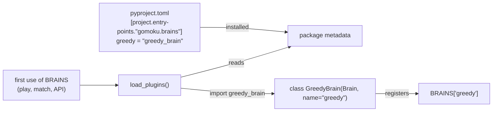

# Writing a Brain

This tutorial builds a small working brain, **greedy**, and plugs it into
every part of the project: `gomoku play`, `gomoku.toml` aliases,
`gomoku match`, the HTTP API and the website's level settings.  The
finished code is in [`examples/greedy-brain/`](../examples/greedy-brain).

## Table of Contents

1. [How brains are found](#how-brains-are-found)
2. [The package](#the-package)
3. [The brain](#the-brain)
4. [Install and play](#install-and-play)
5. [Settings and aliases](#settings-and-aliases)
6. [Measure it](#measure-it)
7. [Test it](#test-it)
8. [On the website](#on-the-website)
9. [Diagnostics (optional)](#diagnostics-optional)
10. [A built-in brain instead of a plug-in](#a-built-in-brain-instead-of-a-plug-in)
11. [Limitations](#limitations)

---

## How brains are found

A brain is a subclass of `gomoku_brain.base.Brain` declared with a name.
The class statement registers it in `gomoku_brain.BRAINS`, and everything
that plays brains (CLI, API, match workers) looks names up there.  See
[ARCHITECTURE.md](ARCHITECTURE.md#ai-brains) for the contract.

A brain only registers when its module is imported.  Built-in brains are
imported by `gomoku_brain` itself; a brain in another package is imported
through an **entry point** in the `gomoku.brains` group:



`load_plugins()` runs once per process, on the first lookup in `BRAINS`.
A plug-in that fails to import, or whose name is already taken, is skipped
with a `PluginWarning` and the other brains keep working.

## The package

```
greedy-brain/
├── pyproject.toml
├── src/greedy_brain/__init__.py
└── tests/test_greedy.py
```

`pyproject.toml`:

```toml
[project]
name = "greedy-brain"
version = "0.1.0"
description = "Example Gomoku brain plug-in: win, block, else the best-scoring move"
requires-python = ">=3.14"
license = "MIT"
dependencies = [
    "gomoku-brain",
]

# The line that makes this package a brain plug-in: gomoku imports the
# module ``greedy_brain`` on start-up, and the class statement inside it
# registers the brain under its name.
[project.entry-points."gomoku.brains"]
greedy = "greedy_brain"

[build-system]
requires = ["hatchling>=1.33.0"]
build-backend = "hatchling.build"

[tool.hatch.build.targets.wheel]
packages = ["src/greedy_brain"]
```

The entry point's value is the module to import.  Its name (`greedy`) only
labels the plug-in in warnings; the brain's name comes from the class.  Use
the same word for both.

## The brain

`src/greedy_brain/__init__.py`:

```python
"""A minimal Gomoku brain: win if it can, block if it must, else play greedily.

The tutorial in ``docs/WRITING_A_BRAIN.md`` walks through this file.
"""

from typing import override

from gomoku.board import Board
from gomoku.models import Move, Stone
from gomoku.rules import check_winner
from gomoku_brain import BaseBrainSettings, Brain
from gomoku_brain.brain_base import BrainSession
from gomoku_brain.candidates import get_candidate_moves
from gomoku_brain.evaluate import evaluate_board
from pydantic import Field


class GreedySettings(BaseBrainSettings):
    """Settings of the greedy brain (``gomoku play --black greedy,radius=1``)."""

    radius: int = Field(default=2, ge=1, le=4, description="Look at empty cells this close to a stone.")


class GreedyBrain(Brain[GreedySettings], name="greedy"):
    """One-ply brain: an immediate win, else a block, else the best evaluation."""

    @override
    def choose_move(self, board: Board, stone: Stone, session: BrainSession) -> Move:
        candidates = get_candidate_moves(board, radius=self.settings.radius)
        opponent = stone.opponent()

        # 1. Five in a row now?
        for move in candidates:
            if check_winner(board.place_stone(move, stone), move):
                return move

        # 2. Would the opponent make five there next move?  Take the cell first.
        for move in candidates:
            if check_winner(board.place_stone(move, opponent), move):
                return move

        # 3. Otherwise the move after which the position looks best for us.
        return max(candidates, key=lambda move: evaluate_board(board.place_stone(move, stone), stone))
```

What each piece does:

| Piece | Role |
|-------|------|
| `GreedySettings(BaseBrainSettings)` | The brain's settings as a pydantic model.  Unknown keys and out-of-range values are errors, on the command line, in `gomoku.toml` and in API requests.  Use `NoBrainSettings` (the default of `Brain`) for a brain without settings. |
| `Brain[GreedySettings]` | Ties the model to the brain; `self.settings` is a validated `GreedySettings`. |
| `name="greedy"` | Registers the class under that name.  A name that is taken (`threat`, …) raises `ValueError`. |
| `choose_move(board, stone, session)` | The one method to write.  *board* is an immutable `Board` that is not full, *stone* the side to move.  Return a legal `Move`; an occupied cell ends the game with `InvalidMoveError`. |
| `get_candidate_moves` | Empty cells near the stones (the centre on an empty board), so a brain need not scan the whole board. |
| `check_winner` | Whether the stone just placed makes five (freestyle: five or more). |
| `evaluate_board` | The project's heuristic score of a position from *stone*'s side. |

Don't override `get_move`: it is final, and wraps `choose_move` in the
tracing span and diagnostics session every brain shares.

## Install and play

Install the package into the project's environment, from the repository
root:

```bash
uv pip install -e examples/greedy-brain    # or the path to your own package
uv run gomoku play --black greedy --white random
```

`-e` (editable) means changes to the source take effect without
reinstalling.

> **`uv sync` removes it.**  `uv sync` makes the environment match the
> lock file exactly, so it uninstalls packages the workspace does not list,
> plug-ins included.  `uv run` does not.  After a `uv sync`, install the
> plug-in again, or sync with `uv sync --inexact`.

Check that it is there:

```bash
uv run python -c "from gomoku_brain import BRAINS; print(sorted(BRAINS))"
```

If it is missing, run `uv run python -c "import greedy_brain"`: the
traceback shows why it does not load (gomoku prints the same reason as a
`PluginWarning`).

## Settings and aliases

Settings work as for any built-in brain:

```bash
uv run gomoku play --black greedy,radius=1 --white greedy
uv run gomoku play --black greedy,radius=9        # error: radius <= 4
```

An alias in `gomoku.toml`:

```toml
[brains.greedy_near]
type = "greedy"
radius = 1
```

```bash
uv run gomoku play --black greedy_near --white random
```

## Measure it

`gomoku match` plays both colours of each opening and reports the score
and an Elo estimate:

```bash
uv run gomoku match --a brain=greedy --b brain=random --games 20
uv run gomoku match --a brain=greedy,radius=1 --b brain=greedy --games 40
uv run gomoku match --a brain=greedy --b brain=threat --games 20
```

Expect greedy to beat `random` nearly every game and to lose to `threat`,
which searches many moves ahead.

## Test it

`tests/test_greedy.py`:

```python
"""Tests of the example greedy brain."""

import pytest
from gomoku.board import Board
from gomoku.game import Game
from gomoku.models import GameConfig, Move, Stone
from gomoku_brain import BRAINS, get_brain
from greedy_brain import GreedyBrain, GreedySettings
from pydantic import ValidationError


def board_with(black: list[tuple[int, int]], white: list[tuple[int, int]]) -> Board:
    board = Board()
    for r, c in black:
        board = board.place_stone(Move(row=r, col=c), Stone.BLACK)
    for r, c in white:
        board = board.place_stone(Move(row=r, col=c), Stone.WHITE)
    return board


def test_registered():
    assert BRAINS["greedy"].brain_cls is GreedyBrain
    assert BRAINS["greedy"].settings_cls is GreedySettings


def test_settings_are_validated():
    assert get_brain("greedy", radius=1).settings.radius == 1
    with pytest.raises(ValidationError):
        GreedyBrain(radius=9)


def test_takes_a_win():
    board = board_with(black=[(7, 3), (7, 4), (7, 5), (7, 6)], white=[(8, 3), (8, 4), (8, 5), (8, 6)])
    assert GreedyBrain().get_move(board, Stone.BLACK) in {Move(row=7, col=2), Move(row=7, col=7)}


def test_blocks_a_win():
    board = board_with(black=[(7, 3), (7, 4), (7, 5), (7, 6)], white=[(0, 0), (0, 14), (14, 0)])
    assert GreedyBrain().get_move(board, Stone.WHITE) in {Move(row=7, col=2), Move(row=7, col=7)}


def test_plays_a_whole_game():
    game = Game(GameConfig(), GreedyBrain(), get_brain("random"))
    result = game.play()
    assert result is not None
```

```bash
uv run pytest examples/greedy-brain/tests
```

Call `get_move`, not `choose_move`, in tests: it is what the game calls.
The example's tests run in the project's CI (see `pytest.pythonpath` in the
root `pyproject.toml`), so the code in this tutorial stays working.

## On the website

The website's engine runs in the API image
(`packages/gomoku-fastapi/Dockerfile`), which has its own environment, so
the plug-in must be installed in the image.  The build arg
`BRAIN_PLUGINS` lists what to install: pip requirement specs separated by
spaces.  Local packages come from the `plugins` build context, mounted at
`/plugins` during the build.

With Docker Compose, two variables set them:

| Variable | Default | Meaning |
|----------|---------|---------|
| `GOMOKU_BRAIN_PLUGINS` | empty (no plug-ins) | Value of `BRAIN_PLUGINS` |
| `GOMOKU_PLUGINS_DIR` | `./examples` | Host directory mounted at `/plugins` |

The example plug-in:

```bash
GOMOKU_BRAIN_PLUGINS=/plugins/greedy-brain docker compose up --build
```

Your own packages, kept in another directory:

```bash
GOMOKU_PLUGINS_DIR=../my-brains \
GOMOKU_BRAIN_PLUGINS="/plugins/brain-one /plugins/brain-two" \
docker compose up --build
```

A plug-in in a git repository, or published as an archive, needs no
directory (`#subdirectory=` points into a repository with more than the
plug-in, `@` picks a branch, tag or commit):

```bash
GOMOKU_BRAIN_PLUGINS="git+https://github.com/you/my-brain.git" docker compose up --build
GOMOKU_BRAIN_PLUGINS="git+https://github.com/you/repo.git@v1.0#subdirectory=brains/mine" docker compose up --build
GOMOKU_BRAIN_PLUGINS="https://example.com/my-brain-1.0.tar.gz" docker compose up --build
```

Without Compose:

```bash
docker build --build-context plugins=examples \
  --build-arg BRAIN_PLUGINS=/plugins/greedy-brain \
  -t gomoku-api -f packages/gomoku-fastapi/Dockerfile .
```

The build prints `brain plug-ins: greedy`.  **It fails if a plug-in does
not load**, so a server never starts with a brain quietly missing.  Once
the image runs, `GET /v1/brains` lists the brain and the website's level
settings (gear icon) offer it, with a form built from its settings model.
Its settings can be set like any brain's: an alias in `gomoku.toml`, or
`brain_overrides` in API requests.

A plug-in's dependency on `gomoku-brain` is met by the copy already in
the image; its other dependencies are installed from PyPI.

## Diagnostics (optional)

With `gomoku play --diagnostics`, each move gets a `MoveDiagnostics`
record that `gomoku analyze` and playback read
([DIAGNOSTICS.md](DIAGNOSTICS.md)).  `session.diag` is that record, or
`None` when diagnostics are off.  To say why a move was played:

```python
        for move in candidates:
            if check_winner(board.place_stone(move, stone), move):
                if session.diag is not None:
                    session.diag.decision_path = "win"
                return move
```

Search statistics go in `session.diag.search_stats`
(`SearchStats(time_ms=session.elapsed_ms(), nodes_searched=...)`).

## A built-in brain instead of a plug-in

A brain meant to ship with the project goes in
`packages/gomoku-brain/src/gomoku_brain/<name>.py` instead, with:

1. an import in `gomoku_brain/__init__.py` (that import registers it) and
   an entry in its `__all__`;
2. its settings model in `gomoku/settings.py`, next to the other brains';
3. tests in `packages/gomoku-brain/tests/`.

No entry point is needed: `gomoku_brain` imports it directly.

## Limitations

- **`gomoku match … rev=<revision>`.**  A match worker for another git
  revision imports that revision's `gomoku_brain`.  Revisions from before
  plug-in support have no `load_plugins` and report `Unknown brain`.  In
  later revisions, the plug-in comes from your environment (the code you
  installed), not from the revision.
- **The Docker image** contains the plug-ins it was built with.  After
  changing a plug-in, rebuild the image (`docker compose up --build`).
- **Brain names are global.**  Two plug-ins with the same name cannot both
  load; the second is skipped with a `PluginWarning`.
